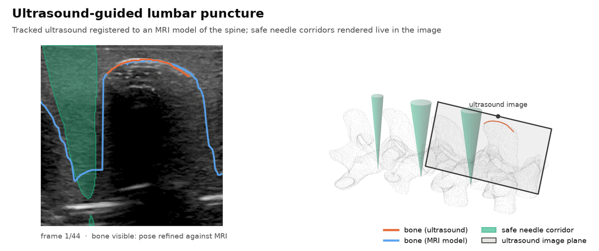
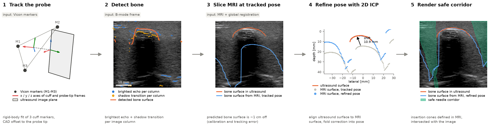
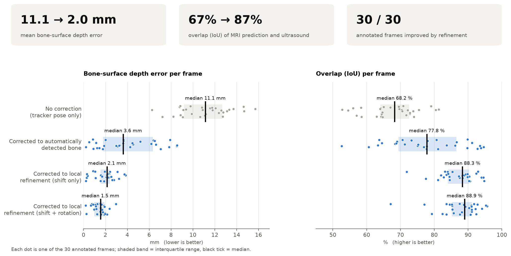
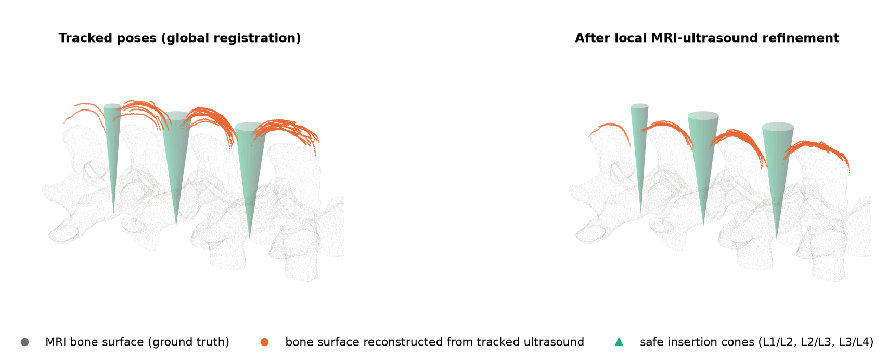
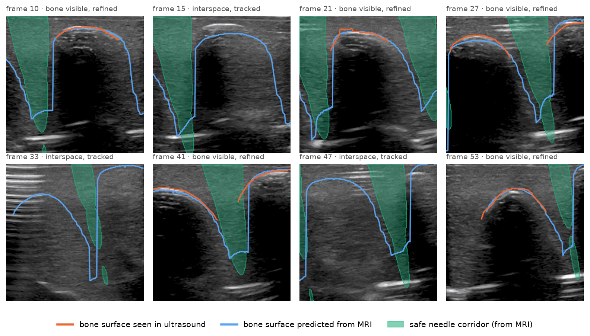

# Ultrasound Image Guidance for Lumbar Puncture

**Registering tracked 2D ultrasound to an MRI model of the spine to show safe needle corridors in the live image.**

Aabha Tamhankar, Christopher Nycz · Worcester Polytechnic Institute · 2024 · [**Thesis**](https://scholar.google.com/citations?view_op=view_citation&hl=en&user=NlcNljEAAAAJ&citation_for_view=NlcNljEAAAAJ:u5HHmVD_uO8C)

<p align="center">
  
</p>

Lumbar puncture is still mostly done blind: the clinician palpates the spinous processes and inserts the needle by feel, and epidural anaesthesia fails in up to 30% of cases in clinical practice (Hermanides et al., BJA 2012). Ultrasound shows bone, but the target (the interspinous gap) sits in the acoustic shadow of that bone, so the image is hard to read.

This project takes a **tracked ultrasound probe** and an **MRI scan of the same anatomy**. It registers the two, then projects a **safe needle-insertion region** defined in the MRI back into each live ultrasound frame. The guidance appears in the image the clinician is already looking at, and the same output could drive a robot.

## Highlights

| | |
|---|---|
| **Pipeline** | Vicon-tracked GE 9L probe → bone-surface extraction → virtual MRI slicing → per-frame MRI–US refinement → safe-region overlay |
| **Registration accuracy** | Bone-surface depth error drops from **11.1 mm → 2.0 mm** after local refinement (30 annotated frames) |
| **Overlap (IoU)** | MRI-predicted vs observed acoustic window: **67.4% → 87.2%**, improved on 30/30 frames |
| **3D consistency** | Ultrasound bone reconstruction to MRI surface, median distance: **8.0 mm → 1.0 mm** |
| **Automatic bone detection** | Median error **0.9 mm** against manual tracing, with no learning involved |
| **Reproducible** | `python scripts/run_pipeline.py` regenerates every number and figure in under 10 s on a laptop CPU |

## Method

<p align="center"></p>

Each numbered panel corresponds to one step below.

1. **Probe tracking** (`lpguide/tracking.py`). A cuff on the probe carries three Vicon markers. Each sample defines an orthonormal frame at the marker centroid. A fixed offset taken from the cuff CAD model maps that frame to the probe tip, which gives ${}^{world}T_{probe}$ for every frame.
2. **Bone surface detection** (`lpguide/bone_detection.py`). Bone in B-mode shows up as a bright specular echo above a dark acoustic shadow. For every image column we find the *brightest echo* and the *shadow transition*, the row that maximises mean intensity above minus mean intensity below. The detector keeps the echo when the two agree and the transition otherwise, then smooths the result. Canny edges and plain thresholding were tried first and were too noisy on this data.
3. **Virtual MRI slicing** (`lpguide/geometry.py`). A one-off global registration maps the tracker frame to the MRI: a 4-point landmark alignment of the L1–L4 spinous-process tips, refined by ICP between the ultrasound bone point cloud and the MRI point cloud (stored in `data/registration/`). For every frame the MRI bone surface is resliced at ${}^{MRI}T_{world}\,{}^{world}T_{probe}$, which predicts where bone should appear in the image. Calibration and tracking errors leave this prediction about 1 cm off.
4. **Local pose refinement** (`lpguide/registration.py`). A 2D ICP aligns the observed bone surface to the predicted one. The resulting in-plane correction is folded back into the probe pose. When no bone is visible (interspace views), the most recent correction carries forward.
5. **Safe-region rendering** (`lpguide/safe_region.py`). One cone per interspace (L1/L2, L2/L3, L3/L4) is defined in the MRI. The apex sits in the interspinous gap and the cone opens towards the skin. Each cone is intersected with the ultrasound beam slab at the corrected pose and drawn on the frame.

## Results

All numbers below come from `results/summary.json`, which is written by `scripts/run_pipeline.py`.

<p align="center"></p>

| Setup (30 annotated frames) | Depth error [mm] ↓ | IoU [%] ↑ |
|---|---:|---:|
| No correction (tracker pose only) | 11.09 | 67.4 ± 7.4 |
| Corrected to automatically detected bone | 3.99 | 77.6 ± 10.9 |
| Corrected to local refinement (shift only) | 1.97 | 87.2 ± 5.1 |
| Corrected to local refinement (shift + rotation) | **1.42** | **87.7 ± 5.8** |

- **Depth error**: mean gap between the MRI-predicted and the ultrasound bone outlines.
- **IoU**: overlap of the tissue above the bone in the MRI prediction and in the ultrasound (central 80×180 px of the image).

**3D reconstruction.** Lifting the traced bone surfaces into 3D with the tracked poses gives a reconstruction that sits about 8 mm off the MRI. After per-frame refinement the reconstruction lies on the MRI surface, with a median distance of 1.0 mm.

<p align="center"></p>

**Safe-region overlays** across the sweep. Interspace frames show the corridor between spinous processes:

<p align="center"></p>

## Quick start

```bash
git clone https://github.com/taabhas/lumbar-puncture-us-guidance.git
cd lumbar-puncture-us-guidance
python -m venv .venv && source .venv/bin/activate
pip install -r requirements.txt

python scripts/run_pipeline.py   # metrics + figures   -> results/
python scripts/make_demo.py      # demo.gif / demo.mp4 -> results/demo/ (needs ffmpeg)
pip install pytest && pytest     # regression tests
```

Tested with Python 3.11, NumPy 2.4, SciPy 1.17, Matplotlib 3.11 and OpenCV 5.0. Open3D, a GPU and the Vicon SDK are not needed.

To use the library on your own frames:

```python
from lpguide.data import load_sweep, load_mri_points, load_global_registration
from lpguide.bone_detection import detect_bone_surface
from lpguide.registration import refine_frame
from lpguide.safe_region import safe_region_mask, overlay

sweep, mri, T_mri_world = load_sweep(), load_mri_points(), load_global_registration()
i = 12
bone = detect_bone_surface(sweep.frames[i])                     # row per column
r = refine_frame(mri, T_mri_world @ sweep.T_world_probe[i], bone)
print(f"IoU {r.iou_before:.1f}% -> {r.iou_after:.1f}%")
img = overlay(sweep.frames[i], safe_region_mask(r.T_mri_probe))
```

## Repository layout

```
lpguide/            core library
  tracking.py         Vicon markers -> probe-tip pose
  bone_detection.py   hybrid brightest-echo / shadow-transition detector
  geometry.py         frames, virtual MRI slicing, bone-surface profiles
  registration.py     2D ICP refinement, IoU and depth-error metrics
  safe_region.py      insertion cones and their projection into the image
  pipeline.py         end-to-end processing of a tracked sweep
  viz.py              overlays and 3D scene
scripts/
  run_pipeline.py     reproduces all metrics and figures
  make_demo.py        renders the demo GIF/MP4
data/               phantom dataset (see data/README.md), ~11 MB
results/            generated figures, metrics.csv, summary.json, demo
tests/              regression tests pinning the reported numbers
```

## Experimental setup

For reproducibility, the dataset and global registration matrix are included in the repository. The original experiment used a single phantom and a single sweep, with no human subjects.
- **Phantom:** Ultrasound Lumbar Puncture Simulator (GT Simulators). No human subject data are included.
- **Ultrasound:** GE Logiq E9 with a 9L linear probe, paramedian view. Frames were captured over DVI→HDMI→USB (Magewell) at the scanner's display resolution.
- **Tracking:** Vicon motion capture with a 3-marker cuff on the probe, sampled in the same loop as the frame grabber.
- **Ground truth:** 3T MRI (GE Signa Premier) of the phantom, segmented to a bone-surface point cloud.

## Thesis

For the full background, method details and discussion, see the thesis:

**[Image Guidance and Safe Insertion Region Localization for Lumbar Puncture using Ultrasound](https://scholar.google.com/citations?view_op=view_citation&hl=en&user=NlcNljEAAAAJ&citation_for_view=NlcNljEAAAAJ:u5HHmVD_uO8C)**  
Aabha Tamhankar · Worcester Polytechnic Institute

## License

Code is released under the [MIT License](LICENSE).
